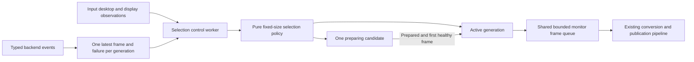
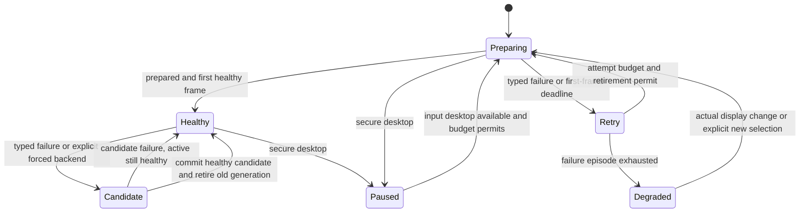

# Monitor backend selection

Issue #126 adds monitor-only DXGI Desktop Duplication behind the existing frame
lease contract. The policy default is WGC; the product `ScreenOwner` prefers
DXGI and falls back to WGC. Window capture remains WGC-only.
The selecting owner contains no LiveKit, encoder, preview or Electron methods.

## Ownership

Backend preparation and stop run on generation workers. A slow candidate cannot
block delivery from a healthy active backend. Callbacks only fill bounded
mailboxes; the control worker alone commits a generation. Generation identity is
preserved through `MonitorCapture` into frame metadata. Retiring a generation
fences its callbacks and prevents another attempt until its worker and external
frame leases drain. A stop deadline failure requires utility retirement.
The converter releases each input view after submitting that frame: cached
COM views otherwise retain old capture textures even after frame leases drain,
including when no next frame is converted after a switch or stop.
The processor and NV12 output pool remain reusable when dimensions are unchanged.

No-content observations do not cause recovery. Display changes alone do not
replace a healthy backend; a typed API failure initiates recovery. Output loss
and device removal remain degraded until a real display change or explicit
selection permits another attempt. A display watcher runs separately from frame
delivery and observes input desktop identity, mode/topology and advanced-color
state. Unsupported/transient HDR queries retain the last known HDR revision.
The environment worker also revalidates the selected source identity. Explicit
absence from the active topology terminates that capture generation and waits
for source availability; it does not depend on WGC sending `Closed`. An inactive
monitor's cached capture item is evicted during stop. The shared cache holds one
MTA usage reference so its WinRT objects cannot outlive the COM runtime when a
generation worker exits. Weak, generation-fenced cache callbacks permit orderly
cache destruction before releasing that reference.

The WGC window callback also checks the actual window visibility before using
frame geometry. WGC can emit minimized-window dimensions before the 25 ms
observer notices the transition. Such frames are drained without pool resize,
generation creation or delivery. The window fixture gates an already-arrived
callback, minimizes the window, then releases it and requires no resize/delivery
work until restoration. This regression also runs under AddressSanitizer.

Scripted owner tests cover an HDR revision while healthy, an unavailable HDR
query while degraded, and recovery after a subsequent real revision. The
hardware evidence covers resolution, refresh, rotation and output removal;
it does not claim a physical HDR-mode toggle on this machine.

## Hard limits

| Resource or transition | Bound |
| --- | --- |
| Live capture generations, including retirement | 2 |
| Candidate generations | 1 |
| First healthy candidate frame | 3 seconds |
| Consecutive failed attempts in an episode | 3 |
| Attempts in a rolling minute | 6 |
| Minimum spacing between attempts | 1 second |
| Generation stop deadline | 3 seconds, capped by caller deadline |
| Shared monitor frames, queued and leased | 3 |
| DXGI owned slots | 3 |
| DXGI textures per generation | 6 desktop/output textures and 1 cursor texture |
| Cursor buffer / dimensions | 1 MiB / 512 × 512 |
| Measured duplication-frame hold budget | 50 milliseconds |

The acquire/copy/release path does not wait for the statistics mutex: acquired
and released counters are published together after `ReleaseFrame` returns.
Diagnostics retain the before-copy, copy and release durations of the single
maximum-hold frame. These are wall-clock observations, including scheduling and
driver-call latency, rather than a cancellable deadline on the Windows API.
Two rejected hardware runs reached 97.9 ms during output removal and 95.9 ms
under contention. Their causes remain unresolved; a later instrumented
contention run reached 9.6 ms, almost entirely in `ReleaseFrame`. A passing
rerun does not explain those failures or establish a fix. The 50 ms gate remains
unchanged. On 2026-09-06 the project owner explicitly accepted this documented
historical risk and authorized merging #126 without further investigation.

An explicit selection starts a new failure episode but cannot reset the rolling
attempt budget. Retained frames keep their slot pool alive and remain included
in generation accounting until released.

## DXGI acquisition and composition

The selected monitor must belong to the existing D3D11 device's adapter. An
adapter mismatch reports `unsupported`; it does not capture another output or
create a cross-adapter CPU copy path.

The worker reserves an owned slot and obtains the immediate-context lock before
calling nonblocking `AcquireNextFrame`. It copies the desktop into that slot,
reads bounded pointer metadata and calls `ReleaseFrame`. Cursor decoding,
rotation/composition and all downstream work happen after release. The measured
hold interval includes `ReleaseFrame` itself, and every successful acquisition
has exactly one release even on failure paths.

The compositor uses a GPU shader for all four rotations and color, masked-color
and monochrome AND/XOR pointers. DXGI pointer position is the shape's top-left;
the hotspot is not subtracted again. Readback is opt-in for controlled tests.
The duplication mode reports oriented desktop dimensions, while acquired
textures remain unrotated. Portrait modes therefore reverse the allocation
width and height before shader rotation. Real 1920 × 1080 ↔ 1080 × 1920
transitions verify this boundary in addition to the small compositor goldens.
Offscreen commands are submitted with asynchronous `Flush`; no GPU wait is
introduced into the capture hold interval. Video-processor automatic image
enhancement is disabled for deterministic conversion.

The pipeline also preserves encoded reference continuity: after discarding a
frame beyond the existing 150 ms age limit, it suppresses dependent frames until
a fresh keyframe. The existing bounded keyframe controller requests recovery.
Publishing dependent frames immediately after a reference drop can corrupt
decoded pixels, including the laboratory timestamp marker. Separate stale and
dependent-drop counters make this recovery visible in the report.

## Verification

The normal CTest suite includes pure policy replay (`backend-selection-policy`,
`backend-selection-golden`), concurrent selecting-owner lifecycle
(`selecting-monitor-capture`), actual DXGI duplication (`dxgi-capture`), pixel
goldens for cursor/rotation and cadence checks. GPU tests carry the
`requires-gpu-video` label and must run on a Windows GPU machine; hosted CI
cannot supply that coverage.

API contracts: [Desktop Duplication and rotated surfaces](https://learn.microsoft.com/en-us/windows/win32/direct3ddxgi/desktop-dup-api),
[asynchronous context submission](https://learn.microsoft.com/en-us/windows/win32/api/d3d11/nf-d3d11-id3d11devicecontext-flush),
[video-processor automatic processing](https://learn.microsoft.com/en-us/windows/win32/api/d3d11/nf-d3d11-id3d11videocontext-videoprocessorsetstreamautoprocessingmode).

Fixture clock: [high-resolution waitable timers](https://learn.microsoft.com/en-us/windows/win32/api/synchapi/nf-synchapi-createwaitabletimerexw).

Lifetime and transition APIs: [MTA usage lifetime](https://learn.microsoft.com/en-us/windows/win32/api/combaseapi/nf-combaseapi-coincrementmtausage),
[temporary display topology](https://learn.microsoft.com/en-us/windows/win32/api/winuser/nf-winuser-setdisplayconfig).
