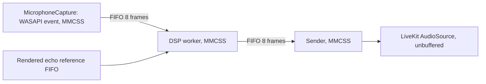

# Microphone

The microphone is warm from application start (capture runs, nothing is sent)
so joining a channel only adds a publication. `MicrophoneOwner` applies the
latest intent on its control thread; `MicrophonePipeline` owns capture and DSP;
`MicrophoneSender` owns the LiveKit publication.

## Lossless hand-offs

Each hand-off is an in-order FIFO of 8 frames (80 ms) that drops the oldest
frame on overflow, and each consumer drains it completely on every wake. A
thread that is briefly descheduled catches up instead of losing all but the
newest frame. Frames older than 100 ms are dropped rather than sent late.

The LiveKit `AudioSource` is unbuffered (`queue_size_ms = 0`), as the SDK
documents for live capture: frames go straight into WebRTC on the capture
clock. A buffered source adds the SDK's own 10 ms clock, which drifts from the
capture clock and drops frames whenever its thread is starved.

`bench/call-bench.mjs`, 15 s phase, average of two runs (frames sent; frames the
phase duration implies in parentheses):

| | before (develop) | after |
| --- | --- | --- |
| Idle machine | 1420 (1500) | 1419 (1500) |
| Every core busy | 1103 (1501) | 1649 (1501) |

The counter is sampled at phase boundaries, so frames delayed across a boundary
land in the next phase: the idle row is equal for both builds, and the loaded
row above 100% is the backlog of a starved moment being sent instead of dropped.

## Capture policy

Shared-mode `IAudioClient2`, category `Other` (never the communications role,
so Windows does not duck other applications), PCM16 48 kHz mono via
`AUTOCONVERTPCM`, follow-default unless an explicit device is selected. A
missing selected device falls back to the default input with the
`microphone_device_fallback` warning. Bypassing system processing requests
WASAPI RAW and falls back to a normal stream if the driver rejects it; RAW is
off by default. MMCSS is a scheduling hint everywhere; its absence never fails
audio. Input failures carry a specific code (`microphone_access_denied`,
`microphone_format_unavailable`, `microphone_device_lost`,
`microphone_no_signal`, ...) with the platform HRESULT.

Device switches are transactional: a candidate capture must deliver three
healthy frames before the DSP switches to it; until then the old capture keeps
running.

## DSP

Per 10 ms frame: LiveKit's fixed-frame WebRTC AEC (with the rendered reference)
and noise suppression, input volume, voice gate, AGC2 adaptive digital gain, a final silence guard for
mute, push-to-talk and the closed gate, and a limiter.
The gate and activity detector measure the post-AEC/NS level before AGC2, so
gain adaptation does not change the gate's dBFS threshold semantics.

- AEC keeps running across renderer epochs (new call, output device switch):
  AEC3 re-estimates delay and re-converges by itself. Renderer epochs are unique
  per process, so a new output never looks like a stale old one.
- The gate holds 300 ms after the last voiced frame and fades out over one
  frame instead of clicking. The speaking indicator shares the hold.
- Mute and push-to-talk are applied inside the DSP, so toggling them never
  reopens capture or republishes.

## Effects and VST 3 plugins

Effects run on the post-AEC/NS voice, before the gate measures it, so the
gate, the speaking indicator, self-monitoring and the call all hear the
processed signal. Third-party plugins never load into the media utility:
`syrnike_audio_plugin_host.exe` (staged with the addon) owns the chain, and the
DSP worker exchanges one 10 ms frame with it through a named shared-memory
section and two events (`audio_plugins/effect_bus`).

- `MicrophoneIntent.effectBusId` names the bus; Electron main starts the host,
  sends its bus ID, and replaces it after a crash with a new ID. A null or not
  yet open bus keeps the voice dry; it is never a microphone failure.
- The worker waits at most 4 ms. A missed deadline leaves that frame dry, and
  frames stay dry without waiting until the host has answered the late one, so
  a hung or dead host costs one deadline, not a stalled call.
- Each slot has its own dry/wet mix with an equal-power law and a 20 ms ramp.
  The dry path is delayed by the plugin latency so a partial mix does not
  comb-filter; a disabled slot fades out and then skips the effect.
- The built-in pitch shifter is a two-head delay sweep, so its wet copy is
  always half a window (1024 samples, 21 ms) behind. It reports that delay, so
  the dry path is aligned and Mix on it blends instead of combing; the whole
  voice is 21 ms later while the effect is mixed in.
- Chains are swapped lock-free at a block boundary. Slots are shared by
  consecutive chains, so reordering keeps plugin state, and plugin objects are
  created and destroyed on the host UI thread, which also runs the editors.
- Built-in effects (EQ, compressor, reverb, pitch, echo) are our own code from
  public-domain algorithms (RBJ biquads, Freeverb). Plugins use the MIT
  Steinberg VST 3 SDK 3.8 hosting sources only. Scanning loads each module in a
  separate host process, so a broken plugin fails only its own entry.
- The catalog is scanned on demand, once per session, when the effect list is
  opened; the result is cached by module mtime and size. Scan processes run
  below normal priority, so loading a heavy module (a sampler takes seconds)
  never starves the call or the UI.

## Publication

The sender publishes `SOURCE_MICROPHONE` without DTX or simulcast on the SDK
operation lane and unpublishes there after it stops submitting. Server mute
revokes the publication while capture stays warm.
