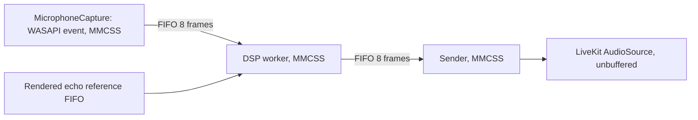

# Microphone

The microphone is warm from application start (capture runs, nothing is sent)
so joining a channel only adds a publication. `MicrophoneOwner` applies the
latest intent on its control thread; `MicrophonePipeline` owns capture and DSP;
`MicrophoneSender` owns the LiveKit publication.

## Lossless hand-offs

Each hand-off is an in-order FIFO of 8 frames (80 ms) that drops the oldest
frame on overflow, and each consumer drains it completely on every wake. A
thread that is briefly descheduled catches up instead of losing all but the
newest frame. Frames older than 100 ms are dropped rather than sent late.

The LiveKit `AudioSource` is unbuffered (`queue_size_ms = 0`), as the SDK
documents for live capture: frames go straight into WebRTC on the capture
clock. A buffered source adds the SDK's own 10 ms clock, which drifts from the
capture clock and drops frames whenever its thread is starved.

Under full CPU load the previous chain sent ~78–85% of captured frames; it now
sends all of them (1718 captured, 1717 sent in a 15 s window).

## Capture policy

Shared-mode `IAudioClient2`, category `Other` (never the communications role,
so Windows does not duck other applications), PCM16 48 kHz mono via
`AUTOCONVERTPCM`, follow-default unless an explicit device is selected. A
missing selected device falls back to the default input with the
`microphone_device_fallback` warning. Bypassing system processing requests
WASAPI RAW and falls back to a normal stream if the driver rejects it; RAW is
off by default. MMCSS is a scheduling hint everywhere; its absence never fails
audio. Input failures carry a specific code (`microphone_access_denied`,
`microphone_format_unavailable`, `microphone_device_lost`,
`microphone_no_signal`, ...) with the platform HRESULT.

Device switches are transactional: a candidate capture must deliver three
healthy frames before the DSP switches to it; until then the old capture keeps
running.

## DSP

Per 10 ms frame: LiveKit's fixed-frame WebRTC AEC (with the rendered reference)
and noise suppression, input volume, voice gate, AGC, a final silence guard for
mute, push-to-talk and the closed gate, and a limiter.

- AEC keeps running across renderer epochs (new call, output device switch):
  AEC3 re-estimates delay and re-converges by itself. Renderer epochs are unique
  per process, so a new output never looks like a stale old one.
- The gate holds 300 ms after the last voiced frame and fades out over one
  frame instead of clicking. The speaking indicator shares the hold.
- Mute and push-to-talk are applied inside the DSP, so toggling them never
  reopens capture or republishes.

## Publication

The sender publishes `SOURCE_MICROPHONE` without DTX or simulcast on the SDK
operation lane and unpublishes there after it stops submitting. Server mute
revokes the publication while capture stays warm.
