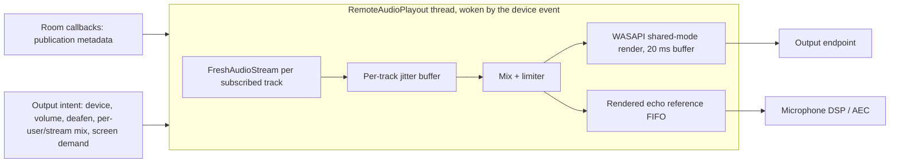

# Remote audio

`RemoteAudioPlayout` (`native/src/audio/remote_audio_playout.*`) turns remote
LiveKit audio into sound on one MMCSS "Pro Audio" thread. The output device
clocks the whole path, the same model WebRTC's audio device module and Discord
use: there is no second or third timer that can drift from the device.

## One wake

1. Apply control changes: subscribe/unsubscribe, create/destroy SDK readers,
   volumes and mutes, deafen, the selected device (or the multimedia default).
2. Drain every `FreshAudioStream` into its track's jitter buffer and update
   speaker activity from decoded microphone PCM.
3. While the device buffer has room for a 10 ms frame, mix one frame from every
   track, write it, and publish exactly that frame (downmixed) as the echo
   reference.

Without a device (none available, or reopening) the loop still consumes at the
decode rate so speaking indicators and buffers stay current.

## Jitter buffer

`RemoteAudioJitter` (`remote_audio_mix.hpp`) holds up to 8 frames per track. It
primes 2 frames (20 ms) before playing, re-primes after an underrun, and trims a
backlog above 6 frames back to 3, so drift between the SDK decode clock and the
device clock can never grow latency without bound. Muted and deafened inputs are
still consumed, so unmute never plays old audio.

## Subscriptions

Microphones are subscribed while connected. Screen-share audio is subscribed only
while that participant's current screen video is demanded by the renderer. SDK
reconnection keeps readers and jitter state; only a disconnect clears the Room.
`attachRoom` precedes connect, `seedConnectedRoom` admits publications that
predate the join, and `detachRoom` waits until readers are released before the
Room is destroyed.

## Device

Output opens `IAudioClient2` in shared event mode at 48 kHz stereo PCM16 with
`AUTOCONVERTPCM`, a 20 ms buffer primed with silence, and a dedicated audio
session GUID. LiveKit mutes its own default process session when built-in
playback is disabled, so product output must not join it. A failed or lost
device is retried every 2 s (250 ms after a render error) while output is
needed; the path reports `Failed` with a retryable code meanwhile. Each opened
device gets a new process-unique renderer epoch for the echo reference.

## Diagnostics

`remote_audio_ingress_metrics`: decoded, SDK dropped/stale/discontinuities,
jitter underruns/overruns/trimmed, readers. `remote_audio_output_metrics`:
rendered frames, device starved, late wakes, device opens, estimated latency
(device latency + 20 ms buffer + deepest jitter queue), device open.

## Measurements

`bench/call-bench.mjs` with three talking participants, 15 s per phase, average
of two runs:

| | before (develop) | after |
| --- | --- | --- |
| SDK frames dropped, idle machine | 0 | 0 |
| SDK frames dropped, every core busy | 926 | 0 |
| Discontinuities, every core busy | 708 | 0 |
| CPU, % of one core | 13.8 | 9.4 |
| Output device switch, ms | 74 | 45 |
| Estimated playout latency | ≈ 38 ms max scheduled age | 30 ms (40–50 ms under load) |
