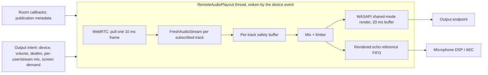

# Remote audio

`RemoteAudioPlayout` (`native/src/audio/remote_audio_playout.*`) turns remote
LiveKit audio into sound on one MMCSS "Pro Audio" thread. The output device
clocks the whole path, the same model WebRTC's audio device module and Discord
use: there is no second or third timer that can drift from the device.

## One wake

1. Apply control changes: subscribe/unsubscribe, create/destroy SDK readers,
   volumes and mutes, deafen, the selected device (or the multimedia default).
   Listener volume and mute are keyed by user id and apply to every Room
   identity (`voice:v1|engine|instance|epoch|operation|userId`) of that user.
   A changed gain ramps across one 10 ms frame instead of stepping.
2. For each 10 ms frame the device buffer can accept, call
   `livekit::pullAudioPlayout()`. WebRTC decodes all receiving tracks and fills
   their sinks synchronously on this thread, across every active Room.
3. Immediately drain every `FreshAudioStream`, update microphone speaker
   activity, mix, write, and publish exactly that frame (downmixed) as the echo
   reference. There is no separate pre-render drain.

The thread enables external SDK playout on entry and restores the SDK timer on
exit, including exceptions. Without a device (none available, or reopening) it
still pulls and consumes every 10 ms so speaking indicators and buffers stay
current. The synthetic ADM's repeating task stays alive but does not pull.

## Jitter buffer

`RemoteAudioJitter` (`remote_audio_mix.hpp`) holds up to 8 frames per track. It
primes with 1 frame, so the newly pulled PCM plays immediately, including after
an underrun. Capacity and trimming a backlog above 6 frames back to 3 remain a
startup/recovery safety net, not a buffer between independent clocks. Muted and
deafened inputs are still consumed, so unmute never plays old audio.

## Subscriptions

Microphones are subscribed while connected. Screen-share audio is subscribed only
while that participant's current screen video is demanded by the renderer. SDK
reconnection keeps readers and jitter state; only a disconnect clears the Room.
`attachRoom` precedes connect, `seedConnectedRoom` admits publications that
predate the join, and `detachRoom` waits until readers are released before the
Room is destroyed.

## Device

Output opens `IAudioClient2` in shared event mode at 48 kHz stereo PCM16 with
`AUTOCONVERTPCM`, a 20 ms buffer primed with silence, and a dedicated audio
session GUID. LiveKit mutes its own default process session when built-in
playback is disabled, so product output must not join it. A failed or lost
device is retried every 2 s (250 ms after a render error) while output is
needed; the path reports `Failed` with a retryable code meanwhile. Each opened
device gets a new process-unique renderer epoch for the echo reference.

## Diagnostics

`remote_audio_ingress_metrics`: decoded, SDK dropped/stale/discontinuities,
jitter underruns/overruns/trimmed, readers. SDK dropped/discontinuities and jitter
underruns also have `_microphone` and `_screen_audio` counters; totals survive
reader replacement. `remote_audio_output_metrics`:
rendered frames, device starved, late wakes, device opens, latency, device open.
Latency is the delay after the SDK: the oldest decoded-ingress age plus jitter
queue, the device buffer and the device latency. The same value goes to
`livekit::setAudioPlayoutDelay`, so WebRTC's audio/video synchronization
accounts for it.

## Earlier measurements

`bench/call-bench.mjs` with three talking participants, 15 s per phase, average
of two runs, before device-pulled SDK decoding:

| | before (develop) | after |
| --- | --- | --- |
| SDK frames dropped, idle machine | 0 | 0 |
| SDK frames dropped, every core busy | 926 | 0 |
| Discontinuities, every core busy | 708 | 0 |
| CPU, % of one core | 13.8 | 9.4 |
| Output device switch, ms | 74 | 45 |
| Estimated playout latency | ≈ 38 ms max scheduled age | 30 ms (40–50 ms under load) |
