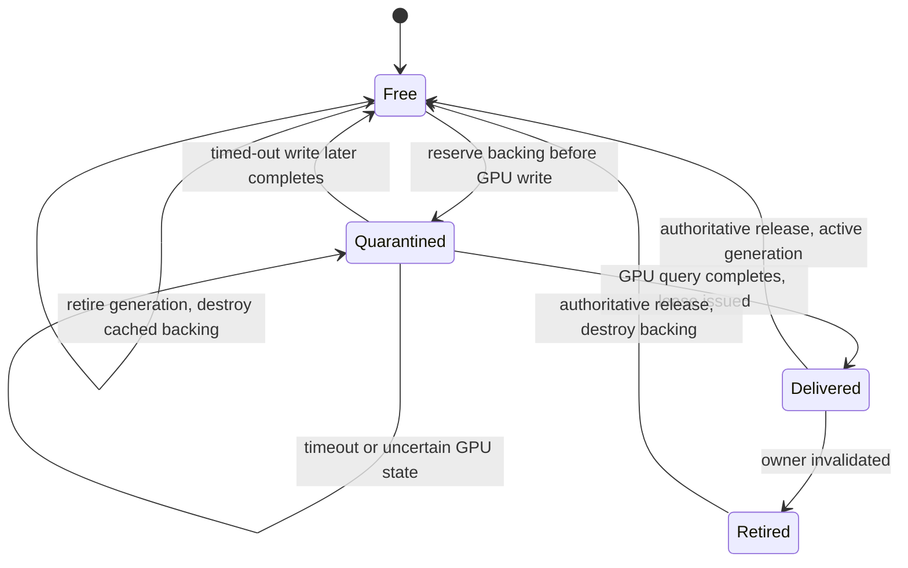

# Remote video receive and Electron texture bridge (#122)

Implemented on Windows, 2026-09-05. This is the opt-in native Media Lab receive
slice, not the Voice UI cutover. The #122 acceptance used published SDK
[`v1.10.0-syrnike.4`](https://github.com/syrnike13/client-sdk-cpp/releases/tag/v1.10.0-syrnike.4)
at commit `7e3a9465733666f6fa463c58d842e3702ed2e646`. Its Windows archive SHA-256
is `06ea330c76bd736fbfc5c46dc997c1d2f965e822a70d86b39bb84b590d7741c1`.
The current application pin is in `packages/windows-media-engine/native/cmake/LiveKitSDK.cmake`.

## Ownership and bounds

`native/src/video/remote_video_track.*` owns one explicitly selected remote
participant/track name. Demand comes from the desktop state, independent of Voice. It
retains the actual publication object and SID, matches subscription callbacks
by object identity, and fences decoded callbacks by revision. Publication,
decoded frame and exported texture have separate lifetimes. The transport
stops its observer before destroying the Room or shutting down the SDK.

SDK callbacks only replace bounded control values. Subscription and teardown
run on an owner worker. A separate reader consumes a capacity-one BGRA
`VideoStream` into one newest-frame slot. The worker accepts increasing source
timestamps and rejects frames waiting more than 250 ms after reader ingress.
There is one unsent output lease. Replacing that unsent output can immediately
return it because no external consumer has seen it.

`SharedTexturePool::processPool()` owns twelve slots across all track owners,
including retired generations. A track holds about three (one unsent output,
one or two in the renderer); with four, a third 30 fps stream dropped most of
its frames once the renderer held each frame 30 ms. A free slot of the same size
is reused first, so streams of different sizes do not reallocate per frame. Its fixed registry permits 16 active owner
generations; retiring one does not invalidate another. Dimensions are bounded
by 3840x2160, and estimated texture backing has an independent 256 MiB ceiling.
The estimate rounds BGRA row pitch to 256 bytes and allocation size to 64 KiB:

| Size | Bytes per slot | Four slots | MiB |
| --- | ---: | ---: | ---: |
| 1920x1080 | 8,323,072 | 33,292,288 | 31.75 |
| 2560x1440 | 14,745,600 | 58,982,400 | 56.25 |
| 3840x2160 | 33,226,752 | 132,907,008 | 126.75 |

Slots are allocated on first use. Twelve 1080p slots fit the budget; at 4K only
seven do, and an upload past the budget is dropped.

This budget covers allocated pool textures, including cached free, retired and
quarantined backing. It is an estimate, not driver memory measurement; SDK
decoder buffers, CPU BGRA frames and Electron compositor allocations are
outside this pool budget. No allocation grows the slot count.



The worker uploads to a shared NT-handle D3D11 BGRA texture under the process
device context mutex. A GPU event query must complete before export. A 200 ms
query deadline or failed keyed-mutex acquisition quarantines the slot; elapsed
time never grants permission to reuse it. A timed-out write keeps its query, and
the slot returns to Free once that query reports completion (a GPU busy with a
game no longer loses slots for good). A failed keyed-mutex acquisition stays
quarantined until the utility process exits. There is no detached reader thread: a stuck
SDK teardown requires containment by the outer process deadline.

## GPU decoding

H.264 never leaves the GPU. Since SDK `v1.10.0-syrnike.16` the application can
install an external video decoder (`livekit::setExternalVideoDecoder`);
`RemoteVideoOwner` installs `video/hardware_video_decoder.*` before any Room.
WebRTC hands it complete access units in decode order, after its jitter buffer
and reference checks, so packet loss and keyframe requests behave as with the
built-in decoder.

The decoder is the Media Foundation H.264 MFT with a DXGI device manager on the
process D3D11 device. That is DXVA, available from every GPU vendor; nothing is
NVIDIA-specific. Low-latency mode returns one picture per access unit. The
D3D11 video processor converts NV12 to BGRA (BT.601/BT.709 and range from the
stream, display aperture instead of the 1088-line coded size) into a
per-decoder output texture, at most eight outstanding. The SDK passes that
frame through Rust and the C++ `VideoStream` as `VideoBufferType::External`
without a copy; the owner copies it into the pool slot on the GPU.

The built-in FFmpeg decoder stays as WebRTC's software fallback: it decodes
when no DXVA decoder exists (virtual machines, remote sessions without a GPU),
when the decoder reports itself unusable (device removed, system-memory
output). An ordinary decode error only requests a keyframe. VP8, VP9 and AV1 tracks use WebRTC's software
decoders and the BGRA path. `remote_video_metrics.gpu_uploaded` counts frames
that took the GPU path.

Pool writes wait on a D3D11 fence without holding the device context lock; a
device without fences falls back to polling the event query.

Measured on 2026-10-11 (RTX 5070 Ti, three H.264 streams 1080p, 720p and 540p at
30 fps, `bench/call-bench.mjs`-style viewer): CPU of the viewer process 56.8 %
of one core before, 12–13 % after; GPU video-decode engine 0 % before, 6.6 %
after; every frame on the GPU path, no drops. With the hardware decoder
disabled the software fallback delivered every frame at 37.8 %.

## Cross-process lease protocol

`apps/desktop/src/main/media-runtime/remote-video-bridge.ts` is the reusable
main-side controller. The media utility owns native media. The main addon
only duplicates/closes NT handles; renderer receives opaque, versioned lease
metadata and an Electron imported texture, never a native pointer or D3D device.

```mermaid
sequenceDiagram
    participant N as Native utility / pool
    participant M as Main bridge
    participant E as Electron GPU lifetime
    participant R as Preload / renderer
    N->>M: v1 lease (generation, sequence, slot, SID, dimensions, local handle)
    M->>E: duplicate handle and import texture
    M->>R: sendSharedTexture + metadata without native handle, hostEpoch
    R->>R: validate epoch/generation/sequence, explicitly draw
    R->>M: presentation diagnostic (not release authority)
    R->>E: VideoFrame.close + imported texture.release
    M->>E: release main imported reference after transfer settles
    E->>M: allReferencesReleased
    M->>N: release exact generation/sequence/slot (retry until ACK)
    N->>M: ACK; reject duplicate or mismatched tuple
```

The bridge retains at most four entries. A timeout/rejection from texture
transfer is not GPU-release evidence. The entry remains quarantined until
Electron proves all references released. A generation change invalidates
presentation but does not force-release exported backing. An old generation's
valid release may destroy its retired texture; it cannot release a newer lease
in the same slot. The immutable driver captures one utility endpoint, fencing
late callbacks from future process epochs. Renderer reload, crash or close
does not reconnect the Room.

Electron's release contract is documented in
[sharedTexture](https://www.electronjs.org/docs/latest/api/shared-texture) and
[SharedTextureImported](https://www.electronjs.org/docs/latest/api/structures/shared-texture-imported).

## Verification

The native fixed pool is tested with actual D3D allocations, multiple active
owners, retirement, invalid/duplicate/late releases and allocation cycles
(`shared-texture-pool`), also under MSVC AddressSanitizer. Hosted Windows CI
runs the portable native subset: its software adapter lacks D3D11 Video
interfaces, so tests labeled `requires-gpu-video` run in the default local
suite. The desktop bridge tests exercise authoritative release/ACK, transfer
timeout, schema bounds and epoch-safe metadata. `bench/call-bench.mjs` measures
first-frame time and FPS of a real remote 1080p30 screen.
