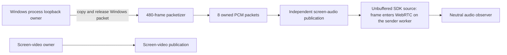

# Screen audio (#125)

Capture, independent publication and desired-state ownership are implemented.

## Capture contract

Both modes require Windows build 20348 or later and successful activation of
`VIRTUAL_AUDIO_DEVICE_PROCESS_LOOPBACK`. Older systems report `unsupported`.
`include_process_tree` includes the selected window's process and descendants.
`system_exclude_client` excludes the **desktop main process and its descendants**,
including utility playback. The caller must provide the validated main-process
identity, not merely the current utility PID. Neither mode silently changes to
endpoint system loopback. The virtual endpoint spans rendering endpoints;
changing the default output does not intentionally select a different capture
source. Device invalidation remains an explicit capture failure.

Each capture uses a distinct WASAPI session GUID. Joining the default process
session lets its output mute/volume suppress loopback PCM, even when the
captured application is audible. The capture session leaves that output state
untouched. The product smoke checks received screen-audio energy while deafened.

Source resolution retains a process handle, validates its creation time and
rechecks the window registry identity. Process exit is observed through the
process handle, independently of video and Room.

The capture thread initializes COM in MTA, waits on sample/stop/process events
and releases each Windows buffer on the same thread that acquired it. It never
calls the SDK. Asynchronous activation retains its own completion state, with
at most one unresolved activation per process; late completion cannot write
into a replacement owner. Activation has a 5-second deadline.

## PCM and clocks

Windows shared-mode conversion produces PCM16, 48 kHz, stereo. Packetization
uses fixed 480-frame / 960-sample arrays (10 ms). The queue owns eight packets;
on overflow the oldest is replaced. Admission and consumption reject packets
older than 100 ms. Generation checks reject late capture after restart or stop.
Discontinuity discards partial packets; silent input produces zeros, and invalid
QPC timestamps are dropped rather than replaced by wall time.

The first sample's `IAudioCaptureClient::GetBuffer` QPC position is already in
100 ns units. Packet offsets are computed from sample counts at 48 kHz. On
Windows this shares the QPC clock used by screen capture and `steady_clock`.
No wall-clock offset or extra queue is used to correct A/V drift.

The SDK source is unbuffered (`queue_size_ms = 0`), like the microphone, and
the loopback device clocks the stream. Since SDK `v1.10.0-syrnike.17`
`captureFrame` hands an unbuffered frame to WebRTC on the calling worker, with
no SDK runtime task or completion callback, so CPU load elsewhere cannot stall
it. The earlier 10 ms clocked mode ran its own timer: it inserted 10 ms of
silence whenever a packet was late and blocked the worker when two arrived
together, after which the backlog guard discarded PCM. A real session measured
98 ms callback waits, up to 244 discarded packets per 12 s and 118 ms packet
age, heard by viewers as crackling and lag.

The queue is FIFO: a backlog after a worker stall drains at once. WebRTC
advances the RTP clock by the samples it receives, and its sender reports map
that clock to capture time, so a gap in capture timestamps (stale or lost
packets) is filled with silent frames, at most 50, before the next packet.
Without them the audio would lag its screen video permanently at every
receiver; `silence_filled` counts them. Packets older than 100 ms are still
rejected at admission and before the SDK call. Capture and sender threads run
in the MMCSS "Audio" class. The SDK call keeps its 500 ms deadline and typed
timeout; telemetry records the maximum call duration as `maximum_callback_wait_us`.

The publication is stereo Opus: `TrackPublishOptions::stereo` sets `TF_STEREO`,
so the server answers the publisher and offers subscribers `stereo=1`.

## Audio/video synchronization

Receivers synchronize screen audio with screen video in WebRTC itself, as
browsers do:

- The LiveKit fork enables `room.sync_streams` by default, so a sender's screen
  video and screen audio (and camera and microphone) share one sync group. LiveKit
  then stops reusing subscriber transceivers.
- Screen video capture times are converted from QPC to WebRTC's clock
  (`timeGetTime()` on Windows, about 30 ms apart from QPC after a day of uptime)
  before they reach the SDK; they anchor the video sender reports.
- Remote playout reports the delay it adds after the SDK (decoded-ingress queue,
  jitter buffer, output device) through `livekit::setAudioPlayoutDelay`; the
  synthetic audio device returns it as `PlayoutDelay`, which WebRTC subtracts
  from the audio playout position.

`bench/call-bench.mjs` measures it with a bot sender whose frames are stamped
150 ms early: the viewer's `estimatedPlayoutTimestamp` difference stays within
10–40 ms.

## Independent lifecycle

`ScreenAudioOwner` consumes monotonically increasing desired revisions.
An absent intent is audio off; on contains a mode and validated process identity.
Equivalent healthy intents do not republish. A newer explicit intent may retry
a recoverable failure. A lost capture device (`device_lost`, `capture_failed`,
`activation_failed`, `format_unavailable`) is the one autonomous exception: a
game switching the display mode can take the HDMI or DisplayPort audio endpoint
with it, so the owner restarts the same intent after 0.5, 1, 2, 4 and 4 seconds
and reports `starting` meanwhile. Ten seconds of running capture refill that
budget; an exhausted budget reports `failed` for an explicit retry.
An endpoint that went away may stop signalling instead of failing a read, so a
second without a packet polls the stream and its invalidation surfaces as
`device_lost` instead of an endlessly silent publication; a silent but valid
stream keeps running. `screen_audio_metrics` reports the last failure code and
the number of automatic restarts. There is no Room/video recovery path.
An uncertain SDK timeout permanently fences that owner from replacement work.

Capture activation precedes publication and both must succeed before `running`.
Superseded startup drains its own session before the latest revision can commit.
Stop drains Windows capture and then its own publication against one deadline.
The session port exposes no video-stop or Room-disconnect method.

Closing a window stops that video's publication. Audio continues while the
explicit audio intent remains on and its process remains alive; process exit
instead reports `target_exited` and terminates only audio. A high-level stop of
the complete screen session must stop both independent paths.

References: [process-tree semantics and minimum build](https://learn.microsoft.com/en-us/windows/win32/api/audioclientactivationparams/ne-audioclientactivationparams-process_loopback_mode),
[buffer ownership and QPC units](https://learn.microsoft.com/en-us/windows/win32/api/audioclient/nf-audioclient-iaudiocaptureclient-getbuffer),
[Microsoft application-loopback example](https://github.com/microsoft/Windows-classic-samples/tree/main/Samples/ApplicationLoopback).

## Verification

`screen-audio-pcm` and `screen-audio-owner` cover fragmented, silent and
discontinuous packets, invalid QPC, generation fencing, 60,000 producer packets
against a stalled consumer, backlog replay on recovery, superseded startup,
explicit retry, automatic restart after device loss, sticky retirement and
concurrent stop. Capture never writes the
level, mute, category or ducking of foreign audio sessions.
