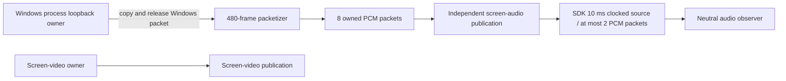

# Screen audio (#125)

Capture, independent publication and desired-state ownership are implemented.

## Capture contract

Both modes require Windows build 20348 or later and successful activation of
`VIRTUAL_AUDIO_DEVICE_PROCESS_LOOPBACK`. Older systems report `unsupported`.
`include_process_tree` includes the selected window's process and descendants.
`system_exclude_client` excludes the **desktop main process and its descendants**,
including utility playback. The caller must provide the validated main-process
identity, not merely the current utility PID. Neither mode silently changes to
endpoint system loopback. The virtual endpoint spans rendering endpoints;
changing the default output does not intentionally select a different capture
source. Device invalidation remains an explicit capture failure.

Each capture uses a distinct WASAPI session GUID. Joining the default process
session lets its output mute/volume suppress loopback PCM, even when the
captured application is audible. The capture session leaves that output state
untouched. The product smoke checks received screen-audio energy while deafened.

Source resolution retains a process handle, validates its creation time and
rechecks the window registry identity. Process exit is observed through the
process handle, independently of video and Room.

The capture thread initializes COM in MTA, waits on sample/stop/process events
and releases each Windows buffer on the same thread that acquired it. It never
calls the SDK. Asynchronous activation retains its own completion state, with
at most one unresolved activation per process; late completion cannot write
into a replacement owner. Activation has a 5-second deadline.

## PCM and clocks

Windows shared-mode conversion produces PCM16, 48 kHz, stereo. Packetization
uses fixed 480-frame / 960-sample arrays (10 ms). The queue owns eight packets;
on overflow the oldest is replaced. Admission and consumption reject packets
older than 100 ms. Generation checks reject late capture after restart or stop.
Discontinuity discards partial packets; silent input produces zeros, and invalid
QPC timestamps are dropped rather than replaced by wall time.

The first sample's `IAudioCaptureClient::GetBuffer` QPC position is already in
100 ns units. Packet offsets are computed from sample counts at 48 kHz. On
Windows this shares the QPC clock used by screen capture and `steady_clock`.
No wall-clock offset or extra queue is used to correct A/V drift.

The SDK source uses its fixed 10 ms clocked mode: its native storage is bounded
to two 10 ms packets and it emits silence when input is absent. The zero-buffer
mode was rejected by the slow-ingress observer test because stopping its audio
clock caused persistent receiver delay after capture resumed. No buffer grows
to smooth drift. After a publication-worker gap over 100 ms, the ingress queue
discards all but the latest packet; freshness is checked again immediately
before the SDK call. The SDK callback deadline is 500 ms, with an explicit typed
timeout and utility-retirement requirement if native completion is uncertain.
The product all-media run observed a successful callback after 155 ms; the old
100 ms completion wait treated that delay as terminal. This deadline bounds the
calling worker, not the audio queue: clocked storage and input-age rejection
remain unchanged. Numeric telemetry records maximum callback wait separately.

## Independent lifecycle

`ScreenAudioOwner` consumes monotonically increasing desired revisions.
An absent intent is audio off; on contains a mode and validated process identity.
Equivalent healthy intents do not republish. A newer explicit intent may retry
a recoverable failure. There is no autonomous retry or Room/video recovery path.
An uncertain SDK timeout permanently fences that owner from replacement work.

Capture activation precedes publication and both must succeed before `running`.
Superseded startup drains its own session before the latest revision can commit.
Stop drains Windows capture and then its own publication against one deadline.
The session port exposes no video-stop or Room-disconnect method.

Closing a window stops that video's publication. Audio continues while the
explicit audio intent remains on and its process remains alive; process exit
instead reports `target_exited` and terminates only audio. A high-level stop of
the complete screen session must stop both independent paths.

References: [process-tree semantics and minimum build](https://learn.microsoft.com/en-us/windows/win32/api/audioclientactivationparams/ne-audioclientactivationparams-process_loopback_mode),
[buffer ownership and QPC units](https://learn.microsoft.com/en-us/windows/win32/api/audioclient/nf-audioclient-iaudiocaptureclient-getbuffer),
[Microsoft application-loopback example](https://github.com/microsoft/Windows-classic-samples/tree/main/Samples/ApplicationLoopback).

## Verification

`screen-audio-pcm` and `screen-audio-owner` cover fragmented, silent and
discontinuous packets, invalid QPC, generation fencing, 60,000 producer packets
against a stalled consumer, backlog discard on recovery, superseded startup,
explicit retry, sticky retirement and concurrent stop. Capture never writes the
level, mute, category or ducking of foreign audio sessions.
