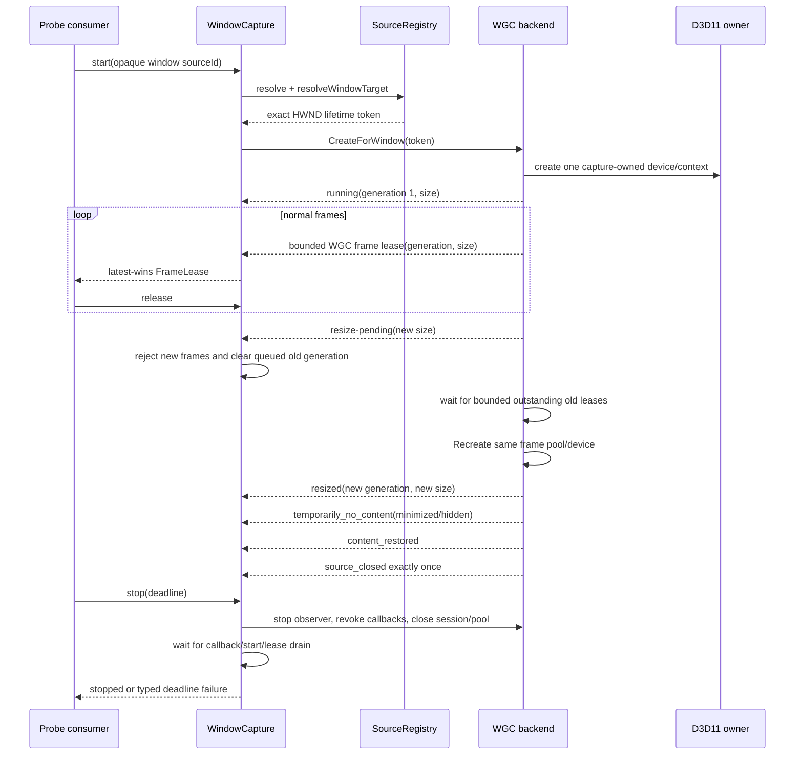

# Isolated WGC window capture

Window capture extends the monitor capture boundary to one exact window lifetime. An opaque window source ID is revalidated by `SourceRegistry`, resolved to an internal `WindowTargetToken`, opened through `IGraphicsCaptureItemInterop::CreateForWindow`, and exposed through the same move-only, three-frame `FrameLease` contract as monitor capture. LiveKit, encoding, Electron, preview, audio, DXGI fallback, replacement-window search, and automatic recovery remain outside this module.

## Resize, no-content, close, and stop sequence

## Capture border

Windows draws a yellow border around a WGC capture unless the session sets
`IsBorderRequired(false)`, and it honours that only after the process called
`GraphicsCaptureAccess::RequestAccessAsync(Borderless)`. Unpackaged desktop apps
are granted this without a prompt (`Allowed`). The request runs once per
process before the first session; window shares, window thumbnails and the WGC
monitor fallback are all borderless. Older Windows keeps the border.

WGC delivers frames at the display refresh rate. The product share sets
`MinUpdateInterval` to half the stream's frame interval (Windows 11 22H2+), so a
165 Hz display does not copy 165 frames a second for a 30 fps stream, while any
refresh rate still delivers at least the stream rate.

Closing the shared window ends the share (`source_closed`/`source_replaced`
turn the screen intent off in `VoiceDirector`), as in Discord, instead of
leaving a failed path and an error banner.

## Identity and terminal behavior

`SourceRegistry::resolveWindowTarget` performs a complete window reconciliation immediately before returning an HWND. The token contains the full registry identity, including process creation, owner thread, class, and WinEvent lifetime epoch; a recycled numerical HWND therefore produces a different opaque source ID. `WindowCapture` resolves the token again after WGC creates the capture item but before publishing `running`, which closes the handle-reuse interval during startup. Capture never searches by title or process and never switches to a replacement window.

`GraphicsCaptureItem::Closed` and explicit destruction observation both converge on one terminal `source_closed` event. The registry revalidates the original identity when that terminal signal arrives, so an observed replacement is recorded as the typed `source_replaced` reason without switching capture to the new window. Terminal close starts and finalizes backend cleanup even when the consumer never calls `stop`. A concurrent explicit stop joins the same serialized cleanup, so close, stop, and resize can commit terminal completion only once. Start returns `source_closed` for a destroyed identity, `source_replaced` for a stale lifetime, `source_unavailable` for an unknown process-local ID, and `source_resolution_failed` when validation infrastructure fails.

## Generation-fenced resize

Frame metadata includes a monotonically increasing generation. When WGC reports a different `ContentSize`, the backend first emits an internal resize-pending transition; `WindowCapture` rejects subsequent old frames and clears its queued leases. The backend retains at most the three already-issued leases, discards incoming frames while they drain, then calls `Direct3D11CaptureFramePool::Recreate` on the same device and pool owner. Only after Recreate succeeds does it publish `resized` and accept frames for the new generation.

This keeps old-size frames observable only through their old generation token and prevents unbounded retired frame pools. A consumer that retains an old lease cannot create more retired generations: resize waits at the single pending generation boundary, and ordinary stop still enforces the same absolute lease deadline as monitor capture.

## Minimize and hidden windows

WGC does not provide a terminal signal for an ordinary period without frames. A joinable, capture-owned observer reports `temporarily_no_content` from explicit Win32 minimized/visibility state and `content_restored` when that state clears; a missing frame is never terminal. WGC may also expose a transient minimized content size, which is handled as an ordinary fenced resize without publishing mixed-size frames.

The observer waits on a condition variable with a 25 ms bound and is joined before session teardown. It captures shared state rather than a raw backend pointer. A minimized or hidden window can remain without frames indefinitely; only close or a typed platform error is terminal.

In the product share, `temporarily_no_content` mutes the published track and
stops static-frame repeats; `content_restored` unmutes it and requests a
keyframe. Viewers see the mute as a paused stream ("Трансляция на паузе")
rather than a frozen frame, the same signal a LiveKit browser viewer gets.

## Stale sessions

A WGC session can stop delivering frames while its window is shown (Discord
logs `stale frame, asking for repaint` and `stale frame, resetting`). The
observer does the same: after 2 s without a frame from a shown, non-hung
window it calls `RedrawWindow(RDW_INVALIDATE | RDW_ALLCHILDREN)`, which only
invalidates and never waits for the target thread. A repainting window answers
with a frame. Without one within 1 s, the frame pool and session are recreated
for the same item and frame handler (at most every 10 s, only with no leased
frames); a new session always delivers a first frame. A pool cannot host a
second session after its first was closed: recreating only the session left
the capture dead. The fixture's `stall` command ignores repaints, so only the
reset produces frames; the bench measures them.

## Fixture and tests

`window-capture` covers generation fencing, cancelled and completed resize, minimize/hide and terminal close against a scripted backend. `bench/call-bench.mjs` shares a real `source_window_fixture.exe` window over WGC end to end.

The process-scoped capture-item cache is bounded at 64 exact live identities, which avoids accumulating WinRT process handles when the same live window is captured repeatedly. `Closed` marks its entry without releasing the item inside its own callback; the next item acquisition prunes closed entries, and the final bounded entry is reclaimed at utility process exit. Session-owned references are still released by the observer after callback drain.
